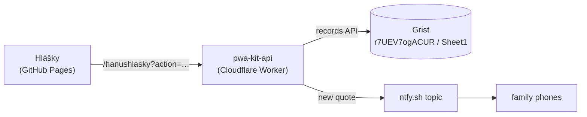

# 🍯 Hanuhlášky

A small installable PWA for writing down the memorable things a kid says. Czech UI,
works offline, and the family gets a push notification on their phones for every new
quote.

Built on [pwa-kit](https://github.com/Alcariss/pwa-kit): the app is hosted on GitHub
Pages, the quotes live in Grist behind the shared `pwa-kit-api` Cloudflare Worker, and
family members sign in with Google or GitHub.



## Develop

```bash
cp .env.example .env   # VITE_API_URL_PRIMARY=https://pwa-kit-api.hanushlasky-api.workers.dev/hanushlasky
npm install
npm run dev            # http://localhost:5173 (allowed by the worker's DEV_ORIGINS)
npm test
npm run typecheck
npm run build
```

Add `?debug=1` to the URL to see where the data came from (server or offline copy).

| File | What it is |
|---|---|
| `src/main.ts` | The app: sign-in screen, install hint, list, add, edit, delete and share quotes |
| `src/quotes.ts` | The quote record, as the worker returns it |
| `src/texts.ts` | Czech strings for sign-in and the install hint |
| `src/styles.css` | App styles; the kit's sign-in, install hint, update banner and debug panel are themed through `--pk-*` |
| `public/icon-*.png` | App icons used by the manifest |

The quotes are cached in `localStorage` under `hlasky:v2:quotes`, so the app opens
instantly and works offline. Signing out clears it.

Update the kit with `npm update @alcariss/pwa-kit` (stays within `^1`).

## Deploy

Every push to `main` deploys through the kit's shared workflow
(`Alcariss/pwa-kit/.github/workflows/deploy-pages.yml@v1`): it runs the tests, builds
with base path `/hanushlasky/` and the commit SHA as the version, and publishes to
GitHub Pages.

The repository needs:

- *Settings → Pages → Source*: **GitHub Actions**
- Repository secret `VITE_API_URL_PRIMARY` =
  `https://pwa-kit-api.hanushlasky-api.workers.dev/hanushlasky`

The old secrets `VITE_API_URL_FALLBACK` and `VITE_API_TOKEN` (Apps Script) are no
longer used and can be deleted.

## Backend (pwa-kit worker)

The app is the `hanushlasky` entry in pwa-kit's `worker/src/apps.ts`: Grist document
`r7UEV7ogACUR`, table `Sheet1` with Text columns `date` (`YYYY-MM-DD`), `text`,
`created_at` and `updated_at`. All signed-in family members share the same quotes.

Worker secrets for this app (run in `pwa-kit/worker`, then `npx wrangler deploy`):

```bash
npx wrangler secret put ALLOWED_EMAILS_HANUSHLASKY   # me@example.com,partner@example.com,…
npx wrangler secret put NTFY_TOPIC_HANUSHLASKY       # long random topic, e.g. `openssl rand -hex 16`
```

Who may sign in is controlled only by `ALLOWED_EMAILS_HANUSHLASKY`; removing an email
revokes that person on their next request. Their Google account must also be a test user
of the worker's Google OAuth client while its consent screen is in *Testing*.

## Installing on iPhone

The sign-in screen shows step-by-step instructions for the browser in use (Safari,
Chrome, or an in-app browser like Messenger). Install **before** signing in: an app
added to the Home Screen on iOS has its own storage, so a sign-in done in Safari does
not carry over.

## Notifications (ntfy)

Whenever someone adds a quote, the worker pushes it through [ntfy](https://ntfy.sh) to
everyone subscribed to the app's secret topic (edits and deletes do not notify). Tapping
the notification opens the app.

For each family member:

1. Install the ntfy app: [iPhone](https://apps.apple.com/app/ntfy/id1625396347),
   [Android](https://play.google.com/store/apps/details?id=io.heckel.ntfy).
2. Tap **+**, enter the topic name (the value of `NTFY_TOPIC_HANUSHLASKY`), keep the
   server `ntfy.sh`, and subscribe.
3. Allow notifications when asked.

Anyone who knows the topic can read and post to it, so share it privately like a
password. To change it, set a new `NTFY_TOPIC_HANUSHLASKY` and have everyone subscribe
again. Without the secret, nothing is sent.

## License

MIT. Built with ❤️ for parents who want to remember their kids' precious words.
