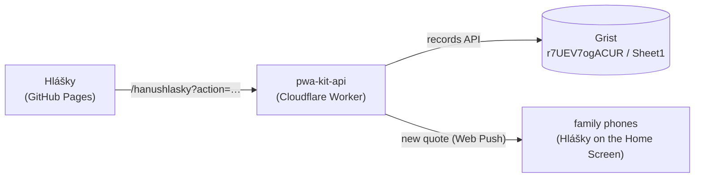

# 🍯 Hanuhlášky

A small installable PWA for writing down the memorable things a kid says. Czech UI,
works offline, and the family gets a push notification on their phones for every new
quote.

Built on [pwa-kit](https://github.com/Alcariss/pwa-kit): the app is hosted on GitHub
Pages, the quotes live in Grist behind the shared `pwa-kit-api` Cloudflare Worker, and
family members sign in with Google or GitHub.



## Develop

```bash
cp .env.example .env   # VITE_API_URL_PRIMARY=https://pwa-kit-api.hanushlasky-api.workers.dev/hanushlasky
npm install
npm run dev            # http://localhost:5173 (allowed by the worker's DEV_ORIGINS)
npm test
npm run typecheck
npm run build
```

Add `?debug=1` to the URL to see where the data came from (server or offline copy).

| File | What it is |
|---|---|
| `src/main.ts` | The app: sign-in screen, install hint, list, add, edit, delete and share quotes |
| `src/quotes.ts` | The quote record, as the worker returns it |
| `src/texts.ts` | Czech strings for sign-in, the install hint and the notifications switch |
| `src/styles.css` | App styles; the kit's sign-in, install hint, update banner and debug panel are themed through `--pk-*` |
| `public/icon-*.png` | App icons used by the manifest |
| `public/pwa-192x192.png` | Copy of the 192 px icon; the kit's service worker shows it on notifications |

The quotes are cached in `localStorage` under `hlasky:v2:quotes`, so the app opens
instantly and works offline. Signing out clears it.

Update the kit with `npm update @alcariss/pwa-kit` (stays within `^1`).

## Deploy

Every push to `main` deploys through the kit's shared workflow
(`Alcariss/pwa-kit/.github/workflows/deploy-pages.yml@v1`): it runs the tests, builds
with base path `/hanushlasky/` and the commit SHA as the version, and publishes to
GitHub Pages.

The repository needs:

- *Settings → Pages → Source*: **GitHub Actions**
- Repository secret `VITE_API_URL_PRIMARY` =
  `https://pwa-kit-api.hanushlasky-api.workers.dev/hanushlasky`

The old secrets `VITE_API_URL_FALLBACK` and `VITE_API_TOKEN` (Apps Script) are no
longer used and can be deleted.

## Backend (pwa-kit worker)

The app is the `hanushlasky` entry in pwa-kit's `worker/src/apps.ts`: Grist document
`r7UEV7ogACUR`, table `Sheet1` with Text columns `date` (`YYYY-MM-DD`), `text`,
`created_at` and `updated_at`. All signed-in family members share the same quotes.

Worker secrets for this app (run in `pwa-kit/worker`, then `npx wrangler deploy`):

```bash
npx wrangler secret put ALLOWED_EMAILS_HANUSHLASKY   # me@example.com,partner@example.com,…
```

Who may sign in is controlled only by `ALLOWED_EMAILS_HANUSHLASKY`; removing an email
revokes that person on their next request. Their Google account must also be a test user
of the worker's Google OAuth client while its consent screen is in *Testing*.

## Installing on iPhone

The sign-in screen shows step-by-step instructions for the browser in use (Safari,
Chrome, or an in-app browser like Messenger). Install **before** signing in: an app
added to the Home Screen on iOS has its own storage, so a sign-in done in Safari does
not carry over.

## Notifications (Web Push)

Whenever someone adds a quote, everyone else who turned notifications on gets it as a
system notification, with a badge on the app icon. Tapping it opens the app. Edits and
deletes do not notify, and you are not notified about your own quotes.

On iPhone (iOS 16.4 or later), for each family member:

1. Open https://alcariss.github.io/hanushlasky/ in Safari and add Hlášky to the Home
   Screen, following the steps on the screen.
2. Open Hlášky **from the Home Screen** and sign in there.
3. Turn on **Upozornění na nové hlášky** and allow notifications when asked.

In Safari itself the switch is not shown: iOS delivers notifications only to apps
added to the Home Screen. On Android and desktop Chrome the switch works in the browser
too.

If notifications were blocked, allow them in *Settings → Notifications → Hlášky* (iPhone)
or the site settings of the browser. Signing out turns notifications off for that
device.

The worker side is configured once for all pwa-kit apps (VAPID keys and the `PUSH` KV
store, see the pwa-kit README); the `hanushlasky` entry has `push` on its `quotes`
table.

## License

MIT. Built with ❤️ for parents who want to remember their kids' precious words.
